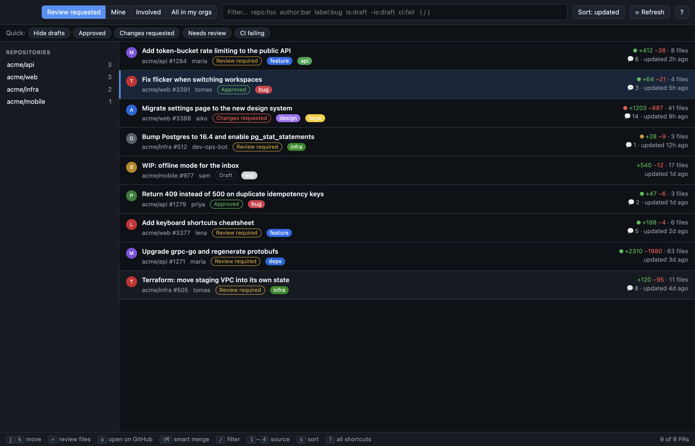
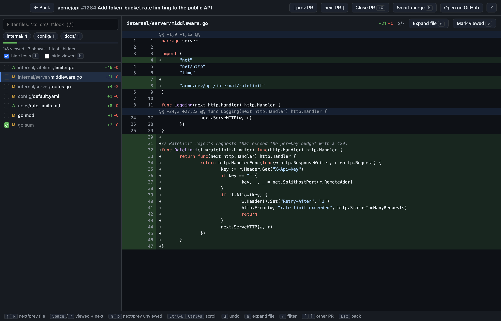
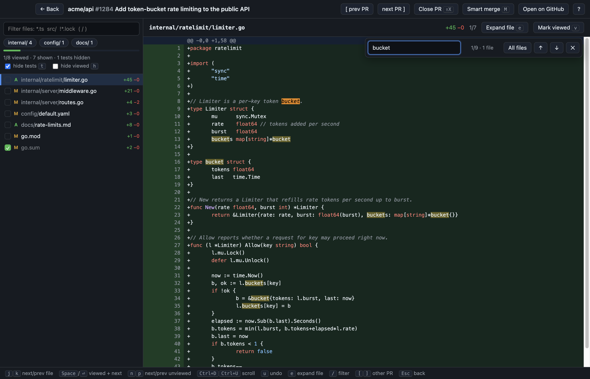
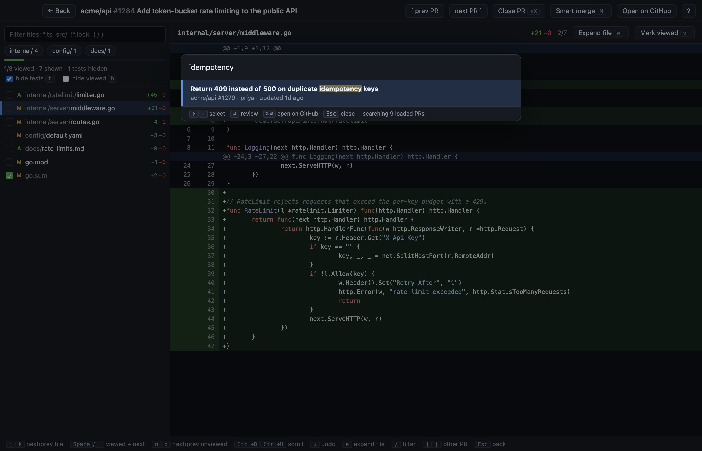

<h1 align="center">LGTM</h1>
<p align="center"><b>Every pull request. One window. Zero mouse.</b></p>
<p align="center">
  A fast, keyboard-first desktop app for reviewing GitHub PRs across all your repos.<br>
  macOS · Windows · Linux · MIT licensed
</p>

<p align="center"></p>

## Stop tab-hopping between repos

GitHub shows you PRs one repo at a time. LGTM shows them **all at once** — across every repo and org you can see — and lets you tear through them from the keyboard.

- **One inbox for everything.** Review requested, yours, involving you, or everything in your orgs. Switch with `1`–`4`.
- **Filter like a power user.** Type `repo:api author:maria label:bug -is:draft ci:fail`, or tap a quick chip. The repo sidebar shows live counts.
- **See what matters at a glance.** Review status, CI, drafts, labels, size and age on every row.

## Review one file at a time

<p align="center"></p>

Open a PR and LGTM walks you through it **file by file** with a clean, syntax-highlighted diff.

- **Mark as viewed, move on.** `Space` marks the file viewed and jumps to the next unviewed one. Made a mistake? `u` undoes it.
- **Synced with GitHub.** Viewed checkmarks are the real ones, so they show up in the web UI too.
- **Cut the noise.** Filter files by name or folder (`*.ts`, `src/`, `!*.lock`). Test files are hidden by default (`t` to show them).
- **Need context?** `e` expands the whole file around your diff.

## Find anything, instantly

<p align="center"></p>

`Cmd/Ctrl+F` searches across **every file in the PR** and jumps between matches. Select any word and every other occurrence lights up immediately.

<p align="center"></p>

`Cmd/Ctrl+K` opens a palette that searches PR **titles and descriptions**. Hit `Enter` and you're reviewing.

## Ship it without leaving the app

- **Smart merge** (`Shift+M`): rebase-merges right away if it can. If the branch is behind, it updates it and turns on auto-merge. If neither works, it updates the branch and tells you what's blocking.
- **Close PR** (`Shift+X`): closes without merging.

## Keyboard cheat sheet

| | List | Review |
|---|---|---|
| Move | `j` `k` | `j` `k` files · `n` `p` unviewed |
| Open | `Enter` | `Space` / `Enter` marks viewed + next |
| Search | `/` filter · `Cmd/Ctrl+K` PRs | `Cmd/Ctrl+F` find · `/` filter files |
| Scroll | `Ctrl+D` `Ctrl+U` | `Ctrl+D` `Ctrl+U` |
| Actions | `Shift+M` merge · `Shift+X` close · `o` GitHub | same · `[` `]` prev/next PR · `Esc` back |

Press `?` in the app for the full list.

## Get started

```sh
git clone https://github.com/rokn/lgtm
cd lgtm
npm install
npm start
```

LGTM signs in with your [GitHub CLI](https://cli.github.com) session if you have one (`gh auth login`). Otherwise paste a personal access token (classic with `repo` scope, or fine-grained with pull requests and contents access). The token is stored encrypted on your machine and only ever sent to GitHub.

### Build an installer

```sh
npm run dist:mac     # .dmg + .zip
npm run dist:win     # installer + portable .exe
npm run dist:linux   # AppImage + .deb
```

Build on the OS you're targeting. Builds are unsigned, so macOS may ask you to right-click → Open the first time.

### Try it without an account

`LGTM_DEMO=1 npm start` runs the app on built-in fake PRs. That's how the screenshots above were made.

## License

[MIT](LICENSE). Free for everyone, no warranty.
